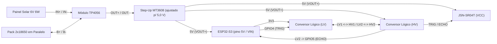

# Monitor de Caixa d'Água (ESP32-S3 + JSN-SR04T + Energia Solar + Home Assistant)

Sistema de monitoramento de nível de caixa d'água (padrão **Fortlev 1.000 L**, com seletor integrado para modelos de **310 L a 5.000 L** nos formatos **Tronco de Cone**, **Cilíndrica Vertical** e **Retangular**, além de ajuste sob medida) alimentado por energia solar e baterias 18650, com integração direta via API ao **Home Assistant (ZimaOS)**, **Telegram** e **ThingSpeak**.

## Lista Exata de Componentes

* **Microcontrolador:** ESP32-S3 com antena externa
* **Sensor de Nível:** Ultrassônico à prova d'água JSN-SR04T
* **Proteção de Sinal:** Conversor de nível lógico bidirecional (5V ↔ 3.3V)
* **Gestão de Carga:** Módulo carregador TP4056 (entrada solar / bateria)
* **Regulação de Tensão:** Módulo elevador Step-Up MT3608 (ajustado para saída de 5V)
* **Alimentação:** Bateria de lítio (2× 18650 EVE 3.200 mAh em paralelo) + Painel solar 6V 6W
* **Proteção Física:** Caixa hermética IP65

---

## 1. Diagrama de Ligação



## 2. Tabela de Fiação Completa

### Alimentação

| Origem | Destino | Observação |
|---|---|---|
| Painel Solar (+ / −) | TP4056 **IN+ / IN−** | Carregamento solar |
| Baterias 18650 (+ / −) | TP4056 **B+ / B−** | Carregue as duas células na mesma tensão antes de unir em paralelo |
| TP4056 **OUT+ / OUT−** | MT3608 **VIN+ / VIN−** | Saída protegida pelo circuito do TP4056 |
| MT3608 **VOUT+** (5,0 V) | ESP32-S3 **5V/VIN**, Conversor Lógico **HV** e JSN-SR04T **VCC** | ⚠️ Ajuste o trimpot do MT3608 para **5,0 V** com multímetro **antes** de conectar o ESP32-S3 |
| MT3608 **VOUT−** | **GND** do ESP32-S3, Conversor Lógico e JSN-SR04T | Todos os GNDs interligados |

### Sinais (ESP32-S3 ↔ Conversor de Nível Lógico ↔ JSN-SR04T)

| ESP32-S3 | Conversor de Nível Lógico (3.3V ↔ 5V) | Módulo JSN-SR04T |
|---|---|---|
| Pino **3V3** | Pino **LV** (referência de baixa tensão) | — |
| Pino **5V / VIN** (da saída do MT3608) | Pino **HV** (referência de alta tensão) | Pino **VCC** (5V) |
| Pino **GND** | Pino **GND** (lado LV e lado HV) | Pino **GND** |
| **GPIO4** (Trigger) | **LV1** → sai pelo **HV1** | Pino **TRIG** |
| **GPIO5** (Echo) | Entra pelo **HV2** → sai pelo **LV2** | Pino **ECHO** |

---

## 3. Integração com o Home Assistant (ZimaOS)

O firmware envia os dados diretamente para a **REST API do Home Assistant** (`POST /api/states/<entity_id>`), funcionando tanto via **HTTPS remoto** (ex.: Cloudflare Tunnel, DuckDNS, Nabu Casa — ideal para testar fora de casa) quanto via **HTTP local** (`http://IP_DO_ZIMAOS:8123`).

### Passo a passo no Home Assistant:
1. Abra o seu **Home Assistant** e clique no seu **Perfil de Usuário** (canto inferior esquerdo).
2. Vá na aba **Segurança** (Security), role até o final em **Tokens de Acesso de Longa Duração** (*Long-Lived Access Tokens*) e clique em **Criar Token**.
3. Dê o nome `ESP32 Caixa d'Agua` e copie o token gerado.
4. No arquivo `config.h`, preencha:
   ```cpp
   #define USE_HOME_ASSISTANT  true
   #define HA_BASE_URL         "https://seu-endereco-remoto-ou-ip:8123"
   #define HA_TOKEN            "SEU_TOKEN_COPIADO_AQUI"
   ```

### Entidades criadas automaticamente no Home Assistant:
Assim que o ESP32-S3 fizer a primeira leitura, estas 6 entidades aparecerão em **Ferramentas de Desenvolvedor → Estados** (prontas para colocar no seu painel Lovelace):
* `sensor.caixa_dagua_nivel` — Nível da água em `%`
* `sensor.caixa_dagua_volume` — Volume estimado em `L`
* `sensor.caixa_dagua_altura_agua` — Altura da coluna d'água em `cm`
* `sensor.caixa_dagua_distancia_sensor` — Distância medida pelo JSN-SR04T em `cm`
* `sensor.caixa_dagua_temp_esp32` — Temperatura interna do chip ESP32-S3 em `°C`
* `sensor.caixa_dagua_wifi_rssi` — Intensidade do sinal Wi-Fi em `dBm`

---

## 4. Geometria da Caixa d'Água (Padrão: Fortlev 1.000 L + Seletor Multi-Modelos)

```text
              ___________  ← topo da tampa: 0,97 m (97 cm) ← SENSOR AQUI (centro da tampa)
            /             \
   0,76 m  |=====================|  ← borda sem tampa (Ø 1,51 m)
           |  ⊐ entrada  ~0,72 m |  ← boia / entrada (~1.000 L = 100%)
            \~~~~~~~~~~~~~~~~~~~/
             \                 /
              \_______________/    ← base (Ø 1,16 m) = 0 m
```

| Parâmetro (Fortlev 1.000 L) | Valor |
|---|---|
| Volume geométrico até a borda (0,76 m) | ~1.070 L |
| **Nível máximo útil** (h = 0,72 m, na altura da boia) | **~1.000 L** |
| Raio em função da altura | `r(h) = 0,580 + 0,2303·h` (m) |
| Volume até a altura h | `V(h) = π·h/3 · (0,580² + 0,580·r(h) + r(h)²)` × 1000 L |

### Modelos Pré-Configurados no Seletor do App e no Bot do Telegram (`/modelo <litros>`)

| Modelo | Formato | Ø Base / Comp. | Ø Topo / Larg. | Altura Boia (100%) | Altura Borda | Altura Sensor |
|---|---|---|---|---|---|---|
| **310 L** | Tronco de Cone | 75 cm | 103 cm | 50 cm | 54 cm | 69 cm |
| **500 L** | Tronco de Cone | 95 cm | 122 cm | 54 cm | 58 cm | 72 cm |
| **750 L** | Tronco de Cone | 100 cm | 135 cm | 69 cm | 73 cm | 86 cm |
| **1.000 L (Padrão)** | **Tronco de Cone** | **116 cm** | **151 cm** | **72 cm** | **76 cm** | **97 cm** |
| **1.500 L** | Tronco de Cone | 143 cm | 175 cm | 77 cm | 83 cm | 105 cm |
| **2.000 L** | Tronco de Cone | 166 cm | 199 cm | 78 cm | 90 cm | 112 cm |
| **3.000 L** | Tronco de Cone | 170 cm | 213 cm | 106 cm | 121 cm | 149 cm |
| **5.000 L** | Tronco de Cone | 185 cm | 237 cm | 145 cm | 163 cm | 197 cm |
| **500 L a 5.000 L** | Cilíndrica Vertical | Ø 85 a 185 cm | — | 88 a 186 cm | 98 a 200 cm | 112 a 220 cm |
| **500 L a 2.000 L** | Retangular / Cisterna | 110 a 160 cm | 90 a 125 cm | 50,5 a 100 cm | 58 a 112 cm | 65 a 125 cm |
| **Personalizado** | Qualquer formato | Ajustável | Ajustável | Ajustável | Ajustável | Ajustável |
