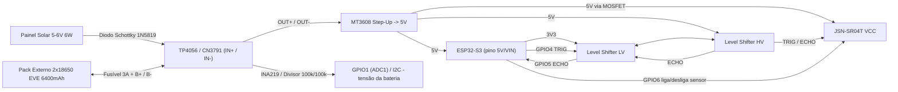
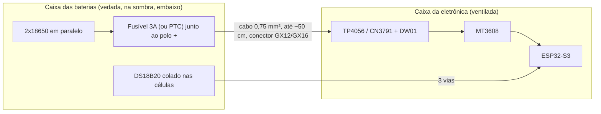

# Monitor Inteligente de Caixa d'Água (ESP32-S3 + JSN-SR04T + Energia Solar)

Sistema completo de monitoramento de nível de caixa d'água (**Fortlev 5.000 L**, formato tronco de cone) alimentado por energia solar, com telemetria de geração fotovoltaica e bateria, proteção térmica de carregamento e alertas via **Telegram + ThingSpeak**.

## Estrutura do Repositório

```text
monitor-caixa-dagua-esp32s3/
├── README.md                                        # Documentação completa de hardware, montagem e cálculos
├── platformio.ini                                   # Configuração para PlatformIO (ESP32-S3)
└── firmware/
    └── monitor_caixa_dagua/
        ├── monitor_caixa_dagua.ino                  # Firmware completo (Arduino IDE / PlatformIO)
        └── config.example.h                         # Modelo de configuração (Wi-Fi, Telegram, ThingSpeak)
```

### Como compilar e gravar
1. Copie o arquivo `firmware/monitor_caixa_dagua/config.example.h` para `firmware/monitor_caixa_dagua/config.h` e preencha o seu `WIFI_SSID`, `WIFI_PASSWORD`, `TELEGRAM_BOT_TOKEN`, `TELEGRAM_CHAT_ID` e `THINGSPEAK_API_KEY`.
2. **No PlatformIO:** abra esta pasta no VS Code / Antigravity e clique em **Upload**.
3. **Na Arduino IDE:** abra `firmware/monitor_caixa_dagua/monitor_caixa_dagua.ino`, selecione a placa **ESP32S3 Dev Module** e instale as bibliotecas `Adafruit INA219`, `OneWire`, `DallasTemperature`, `UniversalTelegramBot` e `ArduinoJson`.

---

## 1. Arquitetura geral



## 2. Ligações (tabela de fiação)

### Energia

| De | Para | Observação |
|---|---|---|
| Painel (+) | Diodo Schottky (ânodo) → cátodo → TP4056 **IN+** | O diodo impede que a bateria descarregue pelo painel à noite |
| Painel (−) | MOSFET AO3400 (corte térmico) → TP4056 **IN−** | Corta o carregamento acima de 45 °C |
| Pack 2×18650 (+/−) | Porta-fusível 3 A → TP4056 **B+ / B−** | |
| TP4056 **OUT+ / OUT−** | MT3608 **VIN+ / VIN−** | Use a versão do TP4056 **com proteção (DW01, 6 pinos)** |
| MT3608 **VOUT+** (5,0 V) | ESP32-S3 **5V/VIN** + Level shifter **HV** + JSN-SR04T **VCC** (via MOSFET) | Ajuste o trimpot do MT3608 **antes** de ligar no ESP32 (meça com multímetro) |
| MT3608 **VOUT−** | GND comum de tudo | **Todos os GNDs devem estar interligados** |

### Sinais

| ESP32-S3 | Level Shifter / Barramento | Periférico |
|---|---|---|
| 3V3 | LV | Alimentação 3,3 V |
| GND | GND (dos dois lados) | GND comum |
| GPIO4 (TRIG) | LV1 ↔ HV1 | JSN-SR04T TRIG |
| GPIO5 (ECHO) | LV2 ↔ HV2 | JSN-SR04T ECHO |
| GPIO6 | — | Gate do MOSFET que liga/desliga o JSN-SR04T |
| GPIO8 (SDA) | I2C SDA | INA219 Solar (0x40) + INA219 Bateria (0x41) |
| GPIO9 (SCL) | I2C SCL | INA219 Solar (0x40) + INA219 Bateria (0x41) |
| GPIO10 | 1-Wire (pull-up 4,7 kΩ p/ 3V3) | DS18B20 no pack externo de baterias |
| GPIO11 | Gate 2N7000 (resistor 1 kΩ) | Corte de carregamento solar (> 45 °C) |
| GPIO1 (ADC1) | — | Ponto central do divisor 100k/100k em B+ (fallback caso não use INA219 #2) |

> [!WARNING]
> **Pinos a evitar no ESP32-S3:** GPIO0, 3, 45 e 46 (strapping), 19 e 20 (USB nativo), 26 a 32 (flash) e 33 a 37 (em placas com PSRAM octal, como a N16R8). Para medir com ADC use sempre o **ADC1 (GPIO1 a GPIO10)**, porque o ADC2 não funciona com o Wi-Fi ligado.

## 3. Geometria da Caixa d'Água (Fortlev 5.000 L, tronco de cone)

```text
             ___________  ← topo da tampa: 2,00 m  ← SENSOR AQUI (centro da tampa)
           /             \
  1,63 m  |=====================|  ← borda (Ø 2,37 m)
          |  ⊐ entrada  ~1,45 m |  ← cano de entrada (15–20 cm abaixo da borda) = NÍVEL MÁXIMO
           \~~~~~~~~~~~~~~~~~~~/
            \                 /
             \_______________/    ← base (Ø 1,85 m) = 0 m
```

| Parâmetro | Valor |
|---|---|
| Volume geométrico até a borda (1,63 m) | ~5.728 L |
| **Nível máximo útil** (h ≈ 1,45 m, na altura da entrada) | **~4.953 L** |
| Raio em função da altura | `r(h) = 0,925 + 0,1595·h` (m) |
| Volume até a altura h | `V(h) = π·h/3 · (0,925² + 0,925·r(h) + r(h)²)` × 1000 L |

### Tabela nível × volume (100% = 1,45 m)

| Altura da água | Litros | % |
|---|---|---|
| 0,20 m | 556 | 11% |
| 0,40 m | 1.151 | 23% |
| 0,60 m | 1.785 | 36% |
| 0,80 m | 2.461 | 50% |
| 1,00 m | 3.178 | 64% |
| 1,20 m | 3.939 | 80% |
| 1,30 m | 4.336 | 88% |
| 1,40 m | 4.745 | 96% |
| 1,45 m | 4.953 | 100% |

## 4. Sistema de Energia e Pack de Baterias Separado

| Item | Valor |
|---|---|
| Banco de baterias | 2× EVE 18650 3.200 mAh em paralelo (1S2P): **6.400 mAh** a 3,6 V |
| Painel solar | 6 V / 6 W monocristalino |
| Consumo estimado (medição a cada 5 min + deep sleep) | ~120 mAh/dia |
| **Autonomia sem sol** | **~45 dias** |



### Corte de carga por temperatura (bateria > 45 °C)

```text
Painel(+) ──► Schottky ──► TP4056 IN+
Painel(−) ──► [D  AO3400  S] ──► TP4056 IN−
                  G ──100k── Painel(+)
                  G ──► 2N7000 ◄── GPIO11  (GPIO11 = HIGH → corta a carga)
```

- **À prova de falha (fail-safe):** se o ESP32 travar ou a bateria acabar, o MOSFET continua conduzindo pelo resistor de pull-up de 100 kΩ e a carga continua normalmente.
- **Histerese:** corta a carga a **45 °C** e retoma a **40 °C** (também corta abaixo de **0 °C**).
