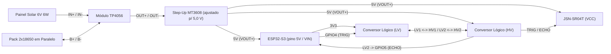

# Monitor de Caixa d'Água (ESP32-S3 + JSN-SR04T + Energia Solar)

Sistema de monitoramento de nível de caixa d'água (**Fortlev 5.000 L**, formato tronco de cone) alimentado por energia solar e baterias 18650, com envio de dados para **ThingSpeak** e alertas via **Telegram**.

## Lista Exata de Componentes

* **Microcontrolador:** ESP32-S3 com antena externa
* **Sensor de Nível:** Ultrassônico à prova d'água JSN-SR04T
* **Proteção de Sinal:** Conversor de nível lógico bidirecional (5V ↔ 3.3V)
* **Gestão de Carga:** Módulo carregador TP4056 (entrada solar / bateria)
* **Regulação de Tensão:** Módulo elevador Step-Up MT3608 (ajustado para saída de 5V)
* **Alimentação:** Bateria de lítio (2× 18650 EVE 3.200 mAh em paralelo) + Painel solar 6V 6W
* **Proteção Física:** Caixa hermética IP65

---

## 1. Diagrama de Ligação



## 2. Tabela de Fiação Completa

### Alimentação

| Origem | Destino | Observação |
|---|---|---|
| Painel Solar (+ / −) | TP4056 **IN+ / IN−** | Carregamento solar |
| Baterias 18650 (+ / −) | TP4056 **B+ / B−** | Carregue as duas células na mesma tensão antes de unir em paralelo |
| TP4056 **OUT+ / OUT−** | MT3608 **VIN+ / VIN−** | Saída protegida pelo circuito do TP4056 |
| MT3608 **VOUT+** (5,0 V) | ESP32-S3 **5V/VIN**, Conversor Lógico **HV** e JSN-SR04T **VCC** | ⚠️ Ajuste o trimpot do MT3608 para **5,0 V** com multímetro **antes** de conectar o ESP32-S3 |
| MT3608 **VOUT−** | **GND** do ESP32-S3, Conversor Lógico e JSN-SR04T | Todos os GNDs interligados |

### Sinais (ESP32-S3 ↔ Conversor de Nível Lógico ↔ JSN-SR04T)

| ESP32-S3 | Conversor de Nível Lógico (3.3V ↔ 5V) | Módulo JSN-SR04T |
|---|---|---|
| Pino **3V3** | Pino **LV** (referência de baixa tensão) | — |
| Pino **5V / VIN** (da saída do MT3608) | Pino **HV** (referência de alta tensão) | Pino **VCC** (5V) |
| Pino **GND** | Pino **GND** (lado LV e lado HV) | Pino **GND** |
| **GPIO4** (Trigger) | **LV1** → sai pelo **HV1** | Pino **TRIG** |
| **GPIO5** (Echo) | Entra pelo **HV2** → sai pelo **LV2** | Pino **ECHO** |

---

## 3. Geometria da Caixa d'Água (Fortlev 5.000 L, tronco de cone)

```text
             ___________  ← topo da tampa: 2,00 m  ← SENSOR AQUI (centro da tampa)
           /             \
  1,63 m  |=====================|  ← borda (Ø 2,37 m)
          |  ⊐ entrada  ~1,45 m |  ← cano de entrada (15–20 cm abaixo da borda) = NÍVEL MÁXIMO
           \~~~~~~~~~~~~~~~~~~~/
            \                 /
             \_______________/    ← base (Ø 1,85 m) = 0 m
```

| Parâmetro | Valor |
|---|---|
| Volume geométrico até a borda (1,63 m) | ~5.728 L |
| **Nível máximo útil** (h ≈ 1,45 m, na altura da entrada) | **~4.953 L** |
| Raio em função da altura | `r(h) = 0,925 + 0,1595·h` (m) |
| Volume até a altura h | `V(h) = π·h/3 · (0,925² + 0,925·r(h) + r(h)²)` × 1000 L |

### Tabela nível × volume (100% = 1,45 m)

| Altura da água | Litros | % |
|---|---|---|
| 0,20 m | 556 | 11% |
| 0,40 m | 1.151 | 23% |
| 0,60 m | 1.785 | 36% |
| 0,80 m | 2.461 | 50% |
| 1,00 m | 3.178 | 64% |
| 1,20 m | 3.939 | 80% |
| 1,30 m | 4.336 | 88% |
| 1,40 m | 4.745 | 96% |
| 1,45 m | 4.953 | 100% |

---

## 4. Como Compilar e Gravar

1. Copie `firmware/monitor_caixa_dagua/config.example.h` para `firmware/monitor_caixa_dagua/config.h` e preencha:
   * `WIFI_SSID` e `WIFI_PASSWORD`
   * `TELEGRAM_BOT_TOKEN` e `TELEGRAM_CHAT_ID`
   * `THINGSPEAK_API_KEY`
2. **PlatformIO:** abra a pasta do projeto e clique em **Upload**.
3. **Arduino IDE:** abra `firmware/monitor_caixa_dagua/monitor_caixa_dagua.ino`, selecione a placa **ESP32S3 Dev Module** e instale as bibliotecas `UniversalTelegramBot` e `ArduinoJson`.
